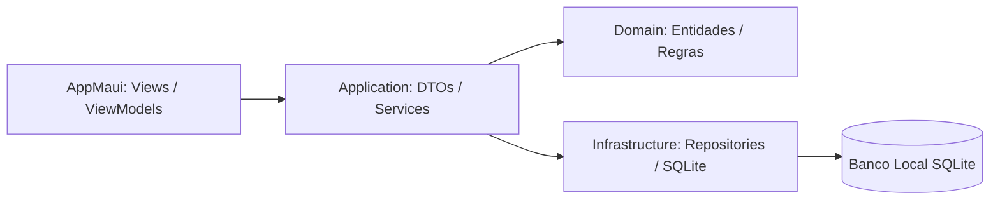

# 🚀 Academia do Zé — Release Notes
### **Versão:** `v1.4.0-aula14-15` &nbsp;|&nbsp; **Data:** 08 de Novembro de 2026 &nbsp;|&nbsp; **Branch:** `aula14-15` / `master`

---

## 🌟 Visão Geral da Versão
Esta versão consolida a entrega das **Aulas 14 e 15**, trazendo o ciclo de vida completo do **Módulo de Matrículas**, aprimoramentos de usabilidade e busca em tempo real, além de um **Easter Egg interativo** especialmente preparado para as configurações do aplicativo.

```
┌────────────────────────────────────────────────────────────────────────┐
│                        ACADEMIA DO ZÉ • v1.4.0                         │
│  🏋️ Matrículas 100% Funcionais  •  🔍 Busca Reativa  •  🎬 Easter Egg   │
└────────────────────────────────────────────────────────────────────────┘
```

---

## ✨ Principais Novidades

### 1. 📋 Módulo Completo de Matrículas (Aulas 14 e 15)
* **Fluxo Completo de Gestão (CRUD):**
  * Cadastro, edição, listagem e cancelamento de matrículas com persistência relacional.
  * Seleção intuitiva de aluno com foto e dados cadastrais integrados.
* **Cálculo Automático de Vigência:**
  * Ao selecionar o tipo de plano (*Mensal, Trimestral, Semestral ou Anual*), a data de término (`DataFim`) é calculada de forma automatizada com base na data de início.
* **Restrições Médicas com Flags Bitwise:**
  * Suporte a restrições médicas combinadas (*Nenhuma, Problemas Cardíacos, Lesão Articular, etc.*) e campo livre para observações detalhadas.
* **Laudo Médico Digital:**
  * Suporte a upload e pré-visualização de comprovantes médicos (PDF e imagens).
* **Regras de Negócio Inegociáveis:**
  * Bloqueio rigoroso de sobreposição: impede cadastrar duas matrículas ativas para o mesmo aluno.

---

### 2. 🔍 Busca Inteligente & Exibição de ID nos Cards
* **Filtros por Nome e CPF:**
  * Adicionados os filtros `"Nome"` e `"CPF"` na listagem de matrículas, definindo `"Nome"` como o filtro padrão.
  * Busca por correspondência parcial (*case-insensitive*), localizando rapidamente alunos como *"Pablo Valente"*.
* **Busca Reativa com Debounce (300ms):**
  * Campo de busca com atualização em tempo real conforme o usuário digita, evitando chamadas repetitivas e garantindo fluidez.
* **Fallback Inteligente:**
  * Caso o usuário mantenha o filtro `"Ativas"` selecionado e digite texto, o sistema filtra inteligentemente pelo nome do aluno entre os matriculados ativos.
* **Identificação Visual `[#ID]`:**
  * O identificador único da matrícula agora é exibido em destaque estilizado junto ao nome do aluno em cada card: `[#1] Pablo Valente Neto`.

---

### 3. 🎬 Easter Egg Secreto nas Configurações
* **Código Secreto:** Digitar o código `"deteuspulos"` no campo de código secreto das Configurações destrava um pop-up interativo.
* **Streaming Local Leve:**
  * Servidor HTTP embutido (`EasterEggVideoServer`) com streaming contínuo sem dependências pesadas externas de pacotes.
  * Exibição limpa em player HTML5 imersivo através de `WebView`, sem barras de rodapé indesejadas.

---

## 🛠️ Correções de Bugs (Bug Fixes)

| Componente | Descrição da Correção | Status |
| :--- | :--- | :---: |
| **Matrícula / Edição** | Correção no mapeamento para permitir remover restrições médicas ao editar (antes permaneciam marcadas). | Resoluído ✅ |
| **Matrícula / Filtro** | Correção no mecanismo de busca que retornava todos os registros ao invés de filtrar pelo nome do aluno digitado. | Resoluído ✅ |
| **Easter Egg / UI** | Removida legenda/rodapé duplicado na parte inferior do modal de vídeo. | Resoluído ✅ |

---

## 🏛️ Qualidade de Código & Arquitetura



* **Clean Architecture & MVVM:** Separação estrita de responsabilidades entre Apresentação, Aplicação, Domínio e Infraestrutura.
* **124 Testes Unitários Aprovados:** Cobertura de regras de negócio de domínio (todas as validações e testes unitários passando com 100% de êxito).
* **Versionamento Git:** Todas as entregas testadas, commitadas e sincronizadas nas branches `aula14-15` e `master`.

---

## 📦 Detalhes do Commit & Git

```bash
a004dfa (HEAD -> aula14-15, origin/aula14-15, origin/master, master)
feat(matricula): adiciona filtro de busca por nome e cpf e exibe id da matricula no card

9866119
fix(matricula): permite remover restricoes medicas ao atualizar matricula

8b82171
fix(easter-egg): remove rodape com descricao no popup do video

9030a38
feat(easter-egg): adiciona surpresa com video ao digitar codigo deteuspulos nas configuracoes

9e28ca5
feat(maui): implementa funcionalidade completa de Matricula - aulas 14 e 15
```

---
*Gerado com carinho pela equipe de desenvolvimento Academia do Zé.* 🏋️‍♂️💪
